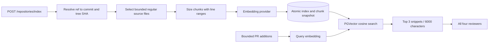

# Phase 7: repository context

Index selected repository files once, then retrieve related snippets when reviewing
a PR. GitHub reads are revision-pinned, embeddings use an injected provider, and
PGVector performs cosine similarity search. No source code is executed.



## Free demonstration

Use a PostgreSQL server with the vector extension available, or the project's
Compose database. Docker builds still need verification on a Docker-capable host.
Set `DATABASE_URL` in your untracked `.env`, then run:

```powershell
.\.venv\Scripts\python.exe -m alembic upgrade head
.\.venv\Scripts\python.exe scripts/index_repository.py --mock --fixture examples/repository_index.json
.\.venv\Scripts\python.exe scripts/review_workflow.py --mock --persist --with-context --review-id 00000000-0000-4000-8000-000000000008 --stop-before-persist
.\.venv\Scripts\python.exe scripts/review_workflow.py --mock --persist --with-context --resume 00000000-0000-4000-8000-000000000008
```

In Compose, replace the Python prefix with `docker compose exec api python`.
Use a fresh UUID when starting the pause demo again. The index fixture supplies
three selected files at the review fixture's synthetic base SHA. Reports show
`context_source=pgvector`, their paths/line ranges/revision/similarity, four findings,
score 7.7, and final COMPLETED with REQUEST_CHANGES. Resume reuses the saved
snippets; it does not query the index or call the models again after aggregation.

`--mock` forces both generation and embedding mocks for the workflow. Mock
embeddings use deterministic lexical feature hashing; they demonstrate storage,
ranking, and injection, not semantic model quality. Reviewer mocks return predefined
fixture findings. No GitHub account or paid API is involved in this fixture demo.
The normalized-file index entry point trusts its caller's commit provenance; it
does not verify that fixture content exists on GitHub.

The original `scripts/review_workflow.py --mock` stays infrastructure-free and
diff-only. Retrieval requires `--persist` in the CLI. Set `RETRIEVAL_ENABLED=true`
to enable it by default, or use `--with-context` for one invocation. `--diff-only`
explicitly disables it, including when resuming older checkpoints.

## Index a real repository

Start the API and request the repository identifier and optional branch/tag/SHA:

```powershell
Invoke-RestMethod -Method Post -Uri http://localhost:8000/repositories/index -ContentType application/json -Body '{"repository":"OWNER/REPOSITORY","ref":"BASE_COMMIT_SHA"}'
```

Omit `ref` to resolve the default branch. The response includes the resolved commit,
embedding profile, file/chunk counts, mock flag, coverage limits, and index timestamp.
This is a bounded synchronous operation, returning HTTP 200 after commit. It does
not enqueue a background indexing job. Invalid input returns 422; unavailable repository 404;
source/provider failures 502; rate limits/storage/configuration problems 503;
deadline expiry 504. Error responses omit source, provider bodies, SQL, and secrets.

Equivalent CLI:

```powershell
.\.venv\Scripts\python.exe scripts/index_repository.py OWNER/REPOSITORY --ref BASE_COMMIT_SHA --mock
```

This CLI's `--mock` only replaces embeddings; it still reads GitHub unless
`--fixture` is supplied. Private repository reads use `GITHUB_TOKEN` with Contents
read permission. All requests remain in `GitHubService`; payload URLs are never
followed. The branch is resolved once, tree traversal uses its tree SHA, and every
file read uses its immutable commit SHA. Symlinks and submodules are excluded.

Supported source extensions include Python, JavaScript/TypeScript, C/C++, Java,
Go, Rust, Markdown, and reStructuredText. Paths under dependencies, build/dist,
generated, hidden directories, virtualenvs, and common generated/minified names
are skipped. Generated headers, invalid UTF-8/binary data, and oversized files are
also skipped. This is a simple policy, not a universal generated-code detector.
Truncated GitHub trees and exhausted file/byte/chunk budgets are reported.

## Providers and limits

Real mode is explicitly configured independently from the review model:

```dotenv
EMBEDDING_MOCK_MODE=false
EMBEDDING_BASE_URL=https://YOUR_PROVIDER/v1
EMBEDDING_MODEL=YOUR_EMBEDDING_MODEL
EMBEDDING_API_KEY=YOUR_KEY_IF_REQUIRED
EMBEDDING_DIMENSIONS=YOUR_MODEL_DIMENSIONS
EMBEDDING_SEND_DIMENSIONS=false
```

The HTTP adapter sends a string batch to `/embeddings` with `encoding_format=float`.
It validates count, unique response indices, dimensions, finite/nonzero vectors,
restores input order, and normalizes vectors. Enable `EMBEDDING_SEND_DIMENSIONS`
only for a provider/model supporting that parameter. Unsupported dimensions or
request parameters fail explicitly; real mode never falls back to mock vectors.
Changing endpoint, model, dimensions, or mock mode selects a separate profile;
reindex before reviewing with that profile. API keys are excluded from its hash.

| Setting | Default | Purpose |
| --- | --- | --- |
| `EMBEDDING_DIMENSIONS` | 128 | Expected vector size; configurable 8–2000 |
| `EMBEDDING_BATCH_SIZE` | 16 | Texts per request; maximum 32 |
| `EMBEDDING_REQUEST_TIMEOUT_SECONDS` | 30 | Per-attempt deadline |
| `EMBEDDING_MAX_ATTEMPTS` | 3 | Bounded transport/429/server retries |
| `INDEX_MAX_FILES` | 100 | Maximum GitHub file fetch attempts / selected fixture files |
| `INDEX_MAX_FILE_BYTES` | 100000 | Per-file UTF-8 size limit |
| `INDEX_MAX_TOTAL_BYTES` | 2000000 | Total selected-file byte budget |
| `INDEX_MAX_CHUNKS` | 1000 | Total stored chunk limit |
| `INDEX_CHUNK_CHARS` | 1800 | Non-overlapping size chunks, preferring line boundaries |
| `INDEX_TIMEOUT_SECONDS` | 180 | Whole indexing operation deadline |
| `MAX_CONTEXT_CHUNKS` | 3 | Top results, maximum 5 |
| `MAX_CONTEXT_CHARS` | 6000 | Total retrieved snippet characters |
| `RETRIEVAL_QUERY_CHARS` | 4000 | Added-code query budget |
| `RETRIEVAL_MIN_SIMILARITY` | 0.15 | Minimum cosine similarity |
| `RETRIEVAL_TIMEOUT_SECONDS` | 45 | Whole retrieval deadline |

Each embedding input is additionally limited to 8192 UTF-8 bytes; multibyte text
is clipped at a valid character boundary for queries and split safely for chunks.
Byte/character budgets are not exact model token counts; provider-specific limits
still apply. Default indexing permits at most 63 batches / 189 HTTP attempts before
the whole-operation deadline, and retrieval permits one query / at most 3 attempts.
Retries respect short numeric Retry-After values; long/unsupported delays defer.
Malformed successful responses and permanent errors are not retried or repaired.

## Storage and retrieval correctness

Migration `0002` adds `repository_indexes` and `repository_chunks`. The snapshot key
is `(lowercase repository, commit SHA, embedding identity)`. Chunks carry ordered
positions, file paths, content, line ranges, and vectors. Variable-length PGVector
columns allow separate dimension profiles without a migration per model. A foreign
key cascades chunk deletion when a snapshot is removed. Downgrade removes these
tables, preserving a potentially shared vector extension.

Indexing fetches and embeds before opening a database transaction. Replacement
updates/locks the snapshot row, removes old chunks, inserts the new set, and commits
atomically. Deleted files disappear when the same snapshot is replaced. Failed
fetches, embeddings, timeouts, or writes preserve the last committed snapshot;
concurrent replacements cannot mix their chunks. An explicitly limited successful
index can replace a previous one and retains its coverage warning. Empty snapshots
are supported. Old revisions/profiles are retained; automatic pruning is later work.

Retrieval only searches the target repository's **exact PR base SHA** and matching
embedding profile/dimensions. It never falls back to the latest index, another
revision, or a fork. Changed and renamed-from paths are excluded so stale versions
of the diff files are not presented as related code. Query text uses bounded added
code, not PR descriptions. Results use PGVector cosine distance with stable path/
ordinal tie-breaks, a similarity threshold, top-k and total-character caps.
After query embedding, a short shared row lock keeps current index coverage
metadata and retrieved snippets consistent during concurrent replacement. No
database transaction or lock spans provider I/O.

This phase uses exact nearest-neighbor search over the filtered snapshot, with a
relational index on chunk ownership. It has no HNSW/IVFFlat index or semantic
reranker. The bounded portfolio corpus does not require approximate search, and
different dimension profiles must not share a fixed-dimension vector index.
SQLite supports migration/storage tests only; vector retrieval requires PostgreSQL.

Missing indexes, incompatible dimensions, limited indexes, or retrieval failures
produce explicit coverage warnings and a PARTIAL review. Expected retrieval failures
preserve diff analysis. Disabled retrieval does not imply a failed review; a valid
index returning no matches is also normal. Cancellation propagates for recovery.
Similarity is supporting context, not proof of a call relationship or correctness.

## Checkpoints and verification

Retrieval-enabled workflows use checkpoint version 3, validating a hash of the
embedding profile and retrieval budgets on resume. Diff-only full reviews remain
version 2, and security-only legacy reviews remain version 1. Use the same modes
and retrieval configuration when resuming. Snippets are JSON checkpoint state;
runtime clients and vectors are not. Reviewers receive identical bounded snippets
as untrusted supporting context and must still cite changed-file patch evidence.
Read APIs retain their existing common finding contract; CLI reports expose
retrieval sources and coverage warnings without dumping graph state.

Tests exercise real PGVector cosine ranking, repository/revision/profile isolation,
index replacement and rollback, concurrent writers, deadlines, safe API failures,
provider envelopes/retries, prompt bounds, and all-reviewer context injection.
A durable checkpoint test removes the index between process/connection lifetimes
and verifies resume reuses saved snippets without new embedding/model requests.
Network calls to GitHub and embedding providers are mocked during verification.
No paid embedding/model requests or GitHub writes have been made.

The Phase 8 [worker](WORKER.md) uses the same context service and version-3 graph
when retrieval is enabled. Repository indexing itself remains a bounded synchronous
API/CLI operation; automatic index scheduling is not implemented.

References: [PGVector](https://github.com/pgvector/pgvector),
[Python/SQLAlchemy integration](https://github.com/pgvector/pgvector-python),
[OpenAI embeddings request format](https://developers.openai.com/api/reference/resources/embeddings/methods/create),
[GitHub trees](https://docs.github.com/en/rest/git/trees),
[commit snapshots](https://docs.github.com/en/rest/commits/commits#get-a-commit).
