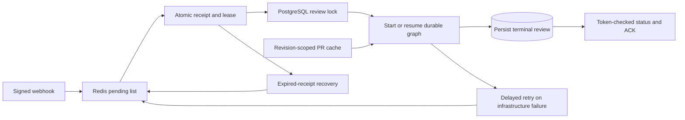

# Phase 8: Redis background processing

Signed webhooks now have a consumer: a separate worker fetches the queued PR
revision, runs the four-reviewer graph, persists the review, and acknowledges its
Redis receipt. The API stays responsive while the worker performs external work.
GitHub publishing remains Phase 9; workers never call the comment-writing method.



## Start the worker

With the configured PostgreSQL/PGVector and Redis services running:

```powershell
.\.venv\Scripts\python.exe -m alembic upgrade head
.\.venv\Scripts\python.exe -m app.worker --mock
```

`--mock` forces free reviewer and embedding providers. **GitHub reads remain real.**
Use a real repository webhook and current PR SHAs, or supply a genuine signed
payload to the existing `scripts/send_webhook.py --payload PATH` helper. The
historical sample webhook has fictional SHAs: it demonstrates acceptance, but a
worker must reject it if GitHub does not return that revision. The standalone
`scripts/review_workflow.py --mock --diff-only` fixture demo still needs no services.

Poll once and process at most one claim, including recovery maintenance:

```powershell
.\.venv\Scripts\python.exe -m app.worker --mock --once
```

An empty queue exits successfully. A future retry is not accelerated by `--once`;
run the continuous worker to promote it when due. Add `--with-context` to use a
matching Phase 7 base-commit index, or `--diff-only` to disable retrieval. Otherwise
the worker follows `RETRIEVAL_ENABLED`. Real models require explicit provider
configuration; mock mode is the default and real mode never silently falls back.

Compose now includes `api`, `worker`, `postgres`, and `redis`:

```powershell
docker compose up --build -d
docker compose logs -f worker
docker compose up -d --scale worker=2
```

The worker waits for the API's healthy startup, after business migrations run.
Each process handles one job at a time; its four reviewers still run concurrently.
Worker instances share environment configuration and use PostgreSQL/Redis ownership
to coordinate the same review. Compose forwards termination signals and allows a
75-second stop window. Container builds/startup remain unverified on this Windows
machine; the same Python worker was exercised as real separate local processes.

For the old enqueue-only sample walkthrough, first run `docker compose stop worker`
so `LLEN reviews:pending` remains observable; restart with `docker compose start worker`.
Avoid running manual review/resume commands on an active worker-owned review ID.
Worker-to-worker coordination does not make unrelated manual callers participate
in the ownership protocol.

## Status and results

The webhook returns HTTP 202 and a review UUID. Duplicate deliveries reuse that
UUID and return the retained current status, including terminal results. Poll:

```powershell
Invoke-RestMethod http://localhost:8000/reviews/REVIEW_UUID/status
Invoke-RestMethod http://localhost:8000/reviews/REVIEW_UUID
```

The Redis status endpoint exposes `review_id`, `status`, `attempts`, safe `error`,
and optional UTC `next_retry_at`. It can report QUEUED before PostgreSQL ingestion.
PROCESSING means an execution attempt began. A delayed retry returns QUEUED with
its scheduled time. Final states preserve the graph's COMPLETED/PARTIAL/FAILED;
an agent failure can produce PARTIAL without restarting successful reviewers.
All agents failing is terminal FAILED, not a new infrastructure retry.

Status reads require Redis, not PostgreSQL. Unknown/expired status is 404; Redis
failure or malformed metadata is a safe 503. Job/status/cache metadata has TTLs.
Permanent review results remain in the existing PostgreSQL read endpoints.
If GitHub ingestion fails before valid PR context exists, there is no fabricated
PostgreSQL review: FAILED is retained in Redis/dead letters, and `/reviews/{id}`
can still return 404. Once ingestion exists, exhausted/permanent execution failure
also finalizes its PostgreSQL row and ends its checkpoint.

## Receipts, leases, and recovery

The existing `reviews:pending` list format is unchanged, including old jobs whose
TTL metadata has expired. Claim peeks/validates a bounded envelope, then an atomic
Lua compare-and-claim removes that exact head, stores its full body in a processing
hash, and creates a unique per-review lease. Concurrent claimers cannot share or
drop the same item. A busy head rotates so other reviews can proceed.

| Redis key | Lifetime / purpose |
| --- | --- |
| `reviews:pending` | Persistent full job envelopes awaiting claims |
| `reviews:processing` | Persistent receipt-token to full-envelope hash |
| `reviews:leases` | Receipt deadlines in Redis server milliseconds |
| `review:{id}:lease` | Expiring token ownership, default 30 seconds |
| `review:{id}:attempts` | Persistent counter until terminal acknowledgement |
| `reviews:delayed` / `reviews:retry_jobs` | Persistent retry deadlines and full envelopes |
| `review:{id}:job`, `:status`, `:metadata` | Expiring job/status/error/retry display data |
| `reviews:dead` | Bounded newest-first failure/quarantine records |
| `github:pr:{hash}` | Expiring normalized PR processing context |

Heartbeats renew at one-third of the lease duration. Every renewal, defer, and ACK
compares the receipt's token and complete envelope; stale owners cannot overwrite
another receipt. Redis failures/ownership loss cancel model work and leave the
receipt recoverable. Redis server time determines deadlines, avoiding differing
worker clocks. Bounded maintenance promotes due retries and requeues expired
receipts. Missing job/status metadata cannot erase a pending, processing, or
delayed payload. Key-type guards run before receipt mutations.

A dedicated PostgreSQL connection holds a session advisory lock for the review.
It runs in autocommit mode, so this is not an open transaction spanning model I/O.
Even when a Redis lease expires while an old process still owns that DB session,
a replacement worker defers rather than running the graph concurrently. Lock
contention does not consume an execution attempt. Locks release on cleanup or
connection death; failed cleanup invalidates the connection instead of returning
a held session lock to the pool.

LangGraph checkpoints save completed nodes and parallel sibling writes. A new
worker validates job/mode/profile identity and resumes pending work. An unfinished
node may run again; checkpointed siblings are reused. If PostgreSQL finalization
committed before a checkpoint or Redis ACK failed, the worker recognizes the
matching terminal row and repairs Redis status without re-running models or
duplicating findings. Resume also recognizes an already committed FAILED row
before restarting pending branches.

This is at-least-once processing, not distributed exactly-once execution. Redis
durability depends on persistence/fsync configuration, and session locks depend on
the live PostgreSQL connection. The Compose Redis service retains AOF in its named
volume; it uses Redis's default fsync policy. This phase does not add Redis Cluster,
failover fencing, global provider quotas, or multi-job concurrency within a process.

## Retry policy and stopping

The default budget is three workflow execution attempts. DB/queue failures before
execution begins preserve the receipt until dependencies recover; they do not
spend model attempts. Transient workflow/checkpoint/GitHub failures schedule bounded
exponential retries (10, 20 seconds by default). There is no worker sleep holding a
claim for the retry delay. GitHub rate limits wait at least one minute, increase on
repetition, and carry supported numeric Retry-After or primary reset windows.
Requested windows beyond seven days fail safely instead of scheduling an early retry.

Stale queued revisions, permanent GitHub rejection, or incompatible checkpoint
configuration fail without repeated execution. Provider/agent repair and transport
budgets remain inside the graph; typed completed agent failures do not receive an
additional worker retry layer. A whole-job timeout can retry pending graph work.
Errors exposed to clients/dead letters are fixed safe messages, never exception
bodies, SQL parameters, provider output, or source text.

Exhausted/permanent infrastructure failures go to the bounded dead-letter list.
Invalid pending/durable envelopes are quarantined with a digest rather than raw
untrusted contents. Identity conflicts do not modify an unrelated stored review.
After fixing a permanent failure, create a new delivery/review ID with current
SHAs, for example from a new PR synchronize event. Repeating the same delivery ID
within its deduplication lifetime does not request another analysis. Automatic
dead-letter redrive and pruning are not included.

Ctrl+C or SIGTERM stops new claims. In-flight work gets a configurable grace
period, then cancellation leaves its receipt/checkpoints for lease-expiry recovery.
An abrupt process kill follows the same recovery path after its lease expires.

| Setting | Default | Meaning |
| --- | --- | --- |
| `REDIS_OPERATION_TIMEOUT_SECONDS` | 3 | Worker Redis socket and status/cache-operation deadline |
| `WORKER_POLL_SECONDS` | 1 | Idle/contended polling interval |
| `WORKER_LEASE_SECONDS` | 30 | Receipt lease, renewed every third of this interval |
| `WORKER_MAX_ATTEMPTS` | 3 | Maximum workflow executions per job |
| `WORKER_RETRY_SECONDS` | 10 | Initial exponential infrastructure backoff |
| `WORKER_JOB_TIMEOUT_SECONDS` | 600 | Whole workflow attempt deadline |
| `WORKER_SHUTDOWN_GRACE_SECONDS` | 15 | Finish window before cancelling on stop |
| `WORKER_MAINTENANCE_BATCH` | 50 | Maximum due entries examined per sorted structure per pass |
| `WORKER_DEAD_LETTER_LIMIT` | 1000 | Maximum retained failure/quarantine records |
| `PR_CACHE_TTL_SECONDS` | 300 | Normalized PR context lifetime |
| `PR_CACHE_MAX_BYTES` | 500000 | Maximum cached UTF-8 JSON size |

## PR cache

Cache keys hash the API origin, credential identity, lowercase repository, PR
number, and exact base/head SHAs. Credentials are not stored in key text. On a
valid hit, one live GitHub metadata read verifies the SHAs and refreshes title/
description/branch metadata; cached file diffs avoid repeated paginated file reads.
A changed head/base rejects the queued revision. Missing, expired, invalid,
oversized, mismatched, or unavailable cache data falls back to normal GitHub reads.
Cache-operation failure alone does not fail ingestion; losing the queue lease
still cancels the owning worker. The cache never substitutes a different revision
and never caches model verdicts. It does not add cross-worker single-flight logic.

## Verification

Unit/integration coverage includes token fencing, concurrent claimers, delayed
retries, corruption/quarantine, TTL-independent payloads, heartbeat loss, graceful
shutdown, deadlines, partial/all-agent failure, retry exhaustion, safe status APIs,
stale PR detection, cache namespaces, real Redis scripts, and PostgreSQL locks.
Real-database tests cover durable checkpoint reopen and final commit/ACK gaps.

Set `TEST_DATABASE_URL` and optionally `TEST_REDIS_URL` to include service checks.
PostgreSQL tests create/remove unique schemas; real Redis tests create/remove only
unique `test:{uuid}:` keys and never flush a database. Without these settings,
SQLite/fakeredis tests run and service-specific cases skip.

Live verification used separate API/worker processes, a real Redis 7.4.11 Windows
port with AOF, PostgreSQL/PGVector, and loopback GitHub/model fixture servers. It
verified healthy HTTP readiness, signed enqueue, completion/status/read APIs,
redelivery, a hard worker kill with three saved sibling outputs, Redis AOF restart,
and resumption of only the interrupted reviewer. No paid provider calls or GitHub
writes occurred. The existing Windows PostgreSQL service was not used.

References: [Redis scripting](https://redis.io/docs/latest/develop/programmability/eval-intro/),
[Redis expiration/conditional SET](https://redis.io/docs/latest/commands/set/),
[PostgreSQL advisory locks](https://www.postgresql.org/docs/current/explicit-locking.html#ADVISORY-LOCKS),
[GitHub retry guidance](https://docs.github.com/en/rest/using-the-rest-api/best-practices-for-using-the-rest-api#handle-rate-limit-errors-appropriately).
