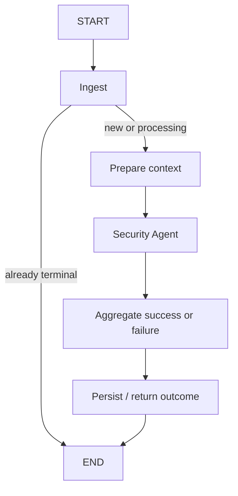

# Phase 5 workflow

The application now has one review graph. The Phase 4 persistence service delegates
to it; standalone agent-only validation remains available through the earlier CLI.



## State and boundaries

`app/graph/state.py` defines `ReviewState` as a typed dictionary. It contains the
review ID, validated job and PR snapshots, bounded review context, security result,
aggregated review, errors, stage names, and lifecycle flags. `errors` and
`completed_stages` use list-add reducers so later parallel branches can contribute
without overwriting another branch's output.

Only JSON primitives are checkpointed. Pydantic objects are validated at node
boundaries and serialized using JSON mode. Sessions, HTTP clients, prompts, API
keys, and settings objects stay in injected runtime dependencies. The result report
includes outcome, findings, errors, and stage progress; it does not dump graph state.

| Node | Behavior | External operations |
| --- | --- | --- |
| `ingest` | Validate the job and exact base/head revision; optionally fetch normalized context; create/mark processing, or reuse a terminal row | GitHub through `GitHubService` if context was omitted; short DB transaction |
| `context` | Prepare bounded diffs and coverage warnings; declare `context_source=diff_only` | None; PGVector is Phase 7 |
| `security` | Run the existing Security Agent and record its typed result | Mock or configured model; no DB transaction |
| `aggregate` | Deduplicate, prioritize, calculate deterministic risk, or carry failed-agent outcome | None |
| `persist` | Atomically save final status/findings or failure; recognize an already-committed terminal result | Short DB transaction when configured |

The graph runs only the Security Agent in this phase. A successful overall review
is therefore `PARTIAL`; the other three reviewers have not run. If security fails,
the graph still reaches aggregation and finalization and records `FAILED`.
No GitHub comment is posted. No Redis work is consumed or acknowledged.

## Checkpoints

`ReviewWorkflow` compiles with a checkpointer and uses the review UUID as `thread_id`.
It requests `durability="sync"` when invoking or resuming, so completed super-step
state is written before the next stage proceeds. The state carries a workflow
schema version plus original mock/persistence modes. Resume rejects unsupported
versions, thread identity mismatches, and incompatible modes.

- **Standalone demo:** `InMemorySaver`. Recovery works while that saver is alive;
  state disappears when its process exits.
- **Persisted CLI workflow:** `AsyncPostgresSaver` using the same configured database
  as business data. Its `review_workflow` schema contains library-managed checkpoint
  tables, separate from Alembic-managed public tables.

The checkpointer uses autocommit, dictionary rows, strict serializer allowlists,
and no pickle fallback. Its `setup()` creates/upgrades its own tables. Alembic
continues to manage only application tables, so a checkpoint library upgrade is
not implemented by editing migration `0001`.

SQLAlchemy business transactions use asyncpg. The official checkpointer uses
Psycopg 3, which needs a selector event loop on Windows; the workflow CLI selects
one explicitly. A programmatic Windows caller must do the same. Linux/Docker does
not need this adjustment.

Checkpoint contents include PR source/diff snapshots and validated findings. Keep
this database internal. A long-lived deployment will also need a checkpoint
retention policy; this portfolio phase does not add an automatic pruning service.

## Run and resume

Run without infrastructure or paid model calls:

```powershell
.\.venv\Scripts\python.exe scripts/review_workflow.py --mock
```

Run with PostgreSQL and intentionally pause after aggregation:

```powershell
.\.venv\Scripts\python.exe -m alembic upgrade head
.\.venv\Scripts\python.exe scripts/review_workflow.py --mock --persist --review-id 00000000-0000-4000-8000-000000000005 --stop-before-persist
```

The report has four completed stages, `paused=true`, and `pending_nodes=["persist"]`.
The application row is already `PROCESSING`. `persisted=false` refers to the final
application outcome, while the graph checkpoint is already durable in PostgreSQL.

Start a new process and resume the same thread:

```powershell
.\.venv\Scripts\python.exe scripts/review_workflow.py --mock --persist --resume 00000000-0000-4000-8000-000000000005
```

The runner calls `ainvoke(None, same_thread_config)` and runs only the pending
node. The final report shows all five stages and `persisted=true`. Repeating resume
reuses the completed checkpoint and reports `reused=true`. A new review needs a
fresh UUID. Starting an existing pending thread is rejected rather than replacing
its state; use `--resume`.

The stop flag is a static debugging breakpoint for demonstrating recovery. It is
not a human-approval product flow. The resume command does not need the original
JSON file because the checkpoint contains validated input. An optional positional
path supplies normalized PR JSON for a new run. Omit `--mock` only after explicitly
configuring a real model; tests and verification use mock providers.

## Failures and side effects

- GitHub and model adapters retain their existing bounded retries. The graph does
  not add another retry layer to the Security Agent.
- Database-backed ingestion/finalization nodes retry a controlled transient DB
  failure at most twice total, with a short backoff. Constraint/configuration errors
  are not retried as transient failures. Retry messages exclude SQL parameters.
- A failed database attempt leaves its graph node pending. Fix the dependency and
  resume the same thread instead of generating another review ID.
- Expected and unexpected agent failures become safe error data, allowing the graph
  to finalize the failed review. Cancellation propagates and preserves recoverable
  progress rather than being labeled a successful empty result.
- Ingestion commits before model work. Finalization uses a fresh transaction, so no
  database transaction spans a model request.
- If finalization commits but its checkpoint fails, replay sees the already terminal
  matching status and does not insert findings again. A conflicting terminal status
  is rejected rather than overwritten.

This provides replay-safe finalization, not a distributed exactly-once guarantee.
A node without a completed checkpoint may run again, including a model call after
a crash before its output became durable. One caller per review thread is required.
Leases, queue acknowledgement, stale-job recovery, and automatic scheduling remain
Phase 8 work. A completed failed-agent result is terminal; repeating resume returns
it. A deliberate new model attempt uses a new job ID.

## Aggregation

`services/aggregation_service.py` contains shared deterministic logic. Same-file,
normalized-title findings within three lines are collapsed; two absent line
citations are treated as duplicates. The strongest severity/confidence wins.
Distinct files and distant line citations remain separate. Findings are sorted by
severity/confidence before persistence. This is lightweight deduplication, not
semantic clustering.

Risk remains `sum(severity_weight × confidence)` with weights 1/2/5/10 and thresholds
1/4/8. The model's advisory score does not select the recommendation. Missing
reviewer categories keep the final status partial. Multi-agent aggregation and
concurrent execution will extend this boundary in Phase 6.

## Verification

Tests cover stage ordering, reducers, JSON-only state, bounded retries, unknown
checkpoint IDs, incompatible resume input/modes/version/thread, agent failure,
cancellation/resume, and same-thread reuse. Persistence integration tests simulate
a commit followed by a checkpoint failure and verify one finding with one model call.

When `TEST_DATABASE_URL` is set, an additional integration test uses the actual
PostgreSQL checkpointer: it closes and rebuilds the connection and graph between
pause and resume. Its checkpoint schema is unique to the test and cleaned up.
Business migrations still pass `alembic check` after checkpoint tables are created.

Implementation references: [LangGraph checkpointers](https://docs.langchain.com/oss/python/langgraph/checkpointers),
[PostgreSQL saver](https://pypi.org/project/langgraph-checkpoint-postgres/).
