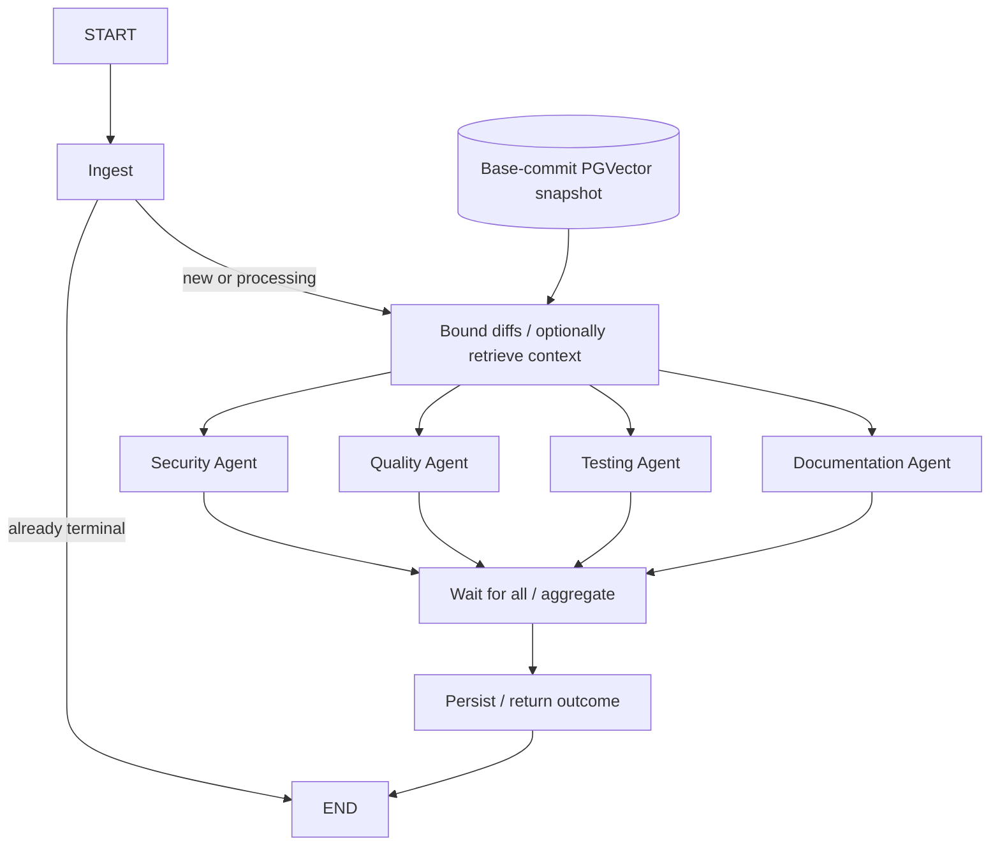

# Phase 8 workflow

The application now has one review graph. The Phase 4 persistence service delegates
to it; standalone agent-only validation remains available through the earlier CLI.



## State and boundaries

`app/graph/state.py` defines `ReviewState` as a typed dictionary. It contains the
review ID, validated job and PR snapshots, bounded review context, per-agent results,
aggregated review, errors, stage names, and lifecycle flags. `errors` and
`completed_stages` use list-add reducers so later parallel branches can contribute
without overwriting another branch's output. `agent_results` uses a dictionary merge
reducer; each branch writes only its own category. A single list-source edge waits
for all configured reviewers before aggregation. There are five logical stages
and eight completed nodes in the default four-reviewer graph. Branch completion
order is unspecified; aggregation uses canonical category ordering.

Only JSON primitives are checkpointed. Pydantic objects are validated at node
boundaries and serialized using JSON mode. Sessions, HTTP clients, prompts, API
keys, and settings objects stay in injected runtime dependencies. The result report
includes outcome, findings, errors, and stage progress; it does not dump graph state.

| Node | Behavior | External operations |
| --- | --- | --- |
| `ingest` | Validate the job and exact base/head revision; optionally fetch normalized context; create/mark processing, or reuse a terminal row | GitHub through `GitHubService` if context was omitted; short DB transaction |
| `context` | Bound diffs; optionally retrieve matching base-revision snippets; record source/coverage | Short snapshot/search reads and one bounded query embedding; no transaction spans network I/O |
| `security`, `quality`, `testing`, `documentation` | Concurrent, distinct role prompts and category-specific schemas; record success or safe failure | Shared async provider; no DB transaction |
| `aggregate` | Deduplicate, prioritize, calculate deterministic risk, or carry failed-agent outcome | None |
| `persist` | Atomically save final status/findings or failure; recognize an already-committed terminal result | Short DB transaction when configured |

All four successful reviewers with full supplied diff coverage produce `COMPLETED`.
Any failed/omitted reviewer or coverage warning produces `PARTIAL`, preserving
successful findings. All reviewers failing produces `FAILED` with safe errors and
no synthetic successful review. A zero-finding partial review cannot approve.
No GitHub comment is posted. The graph itself does not consume Redis; the separate
[worker](WORKER.md) claims jobs, owns execution, and acknowledges terminal results.

## Checkpoints

`ReviewWorkflow` compiles with a checkpointer and uses the review UUID as `thread_id`.
It requests `durability="sync"` when invoking or resuming, so completed super-step
state is written before the next stage proceeds. The state carries a workflow
schema version plus original mock/persistence modes. Resume rejects unsupported
versions, reviewer-set mismatches, thread identity mismatches, and incompatible modes.
The full graph uses version 2. `--security-only` preserves the Phase 5 version 1
topology and supports its old checkpoints, including those without `expected_agents`.
Existing security-only threads cannot silently change into four-agent reviews.
Retrieval-enabled graphs use version 3 and validate a hash of the embedding profile
and retrieval budgets. Diff-only graphs retain versions 1/2, selected with
`--diff-only` when environment defaults enable retrieval. Saved snippets are reused
on resume even if the live index has changed or been removed.

- **Standalone demo:** `InMemorySaver`. Recovery works while that saver is alive;
  state disappears when its process exits.
- **Persisted CLI workflow:** `AsyncPostgresSaver` using the same configured database
  as business data. Its `review_workflow` schema contains library-managed checkpoint
  tables, separate from Alembic-managed public tables.

The checkpointer uses autocommit, dictionary rows, strict serializer allowlists,
and no pickle fallback. Its `setup()` creates/upgrades its own tables. Alembic
continues to manage only application tables, so a checkpoint library upgrade is
not implemented by editing business migrations. Current application revision is 0002.

SQLAlchemy business transactions use asyncpg. The official checkpointer uses
Psycopg 3, which needs a selector event loop on Windows; the workflow CLI selects
one explicitly. A programmatic Windows caller must do the same. Linux/Docker does
not need this adjustment.

Checkpoint contents include PR diffs, retrieved source snippets, and validated findings. Keep
this database internal. A long-lived deployment will also need a checkpoint
retention policy; this portfolio phase does not add an automatic pruning service.

## Run and resume

Run without infrastructure or paid model calls:

```powershell
.\.venv\Scripts\python.exe scripts/review_workflow.py --mock
```

Run with PostgreSQL and intentionally pause after aggregation:

```powershell
.\.venv\Scripts\python.exe -m alembic upgrade head
.\.venv\Scripts\python.exe scripts/review_workflow.py --mock --persist --review-id 00000000-0000-4000-8000-000000000006 --stop-before-persist
```

The report has seven completed nodes, `paused=true`, and `pending_nodes=["persist"]`.
The application row is already `PROCESSING`. `persisted=false` refers to the final
application outcome, while the graph checkpoint is already durable in PostgreSQL.

Start a new process and resume the same thread:

```powershell
.\.venv\Scripts\python.exe scripts/review_workflow.py --mock --persist --resume 00000000-0000-4000-8000-000000000006
```

The runner calls `ainvoke(None, same_thread_config)` and runs only the pending
node. The final report shows eight completed nodes and `persisted=true`. The mock
fixture yields four findings, score 7.7, COMPLETED, and REQUEST_CHANGES. These are
predefined fixture outputs, not evidence of general model analysis. Repeating resume
reuses the completed checkpoint and reports `reused=true`. A new review needs a
fresh UUID. Starting an existing pending thread is rejected rather than replacing
its state; use `--resume`.

The stop flag is a static debugging breakpoint for demonstrating recovery. It is
not a human-approval product flow. The resume command does not need the original
JSON file because the checkpoint contains validated input. An optional positional
path supplies normalized PR JSON for a new run. Omit `--mock` only after explicitly
configuring a real model; tests and verification use mock providers.

## Failures and side effects

- GitHub and model adapters retain their existing bounded retries. The graph does
  not add another retry layer to reviewers. Each permits one structured-output
  repair; default transport bounds allow at most six HTTP attempts per reviewer.
- Each reviewer has an independent `AGENT_TIMEOUT_SECONDS` deadline (default 210).
  Timeout, provider error, invalid output after repair, and unexpected exceptions
  become typed failed results. Successful sibling results remain available.
- Database-backed ingestion/finalization nodes retry a controlled transient DB
  failure at most twice total, with a short backoff. Constraint/configuration errors
  are not retried as transient failures. Retry messages exclude SQL parameters.
- A failed database attempt leaves its graph node pending. Fix the dependency and
  resume the same thread instead of generating another review ID.
- Expected and unexpected agent failures become safe error data, allowing the graph
  to finalize the failed review. Cancellation propagates and preserves recoverable
  progress rather than being labeled a successful empty result.
- Parallel pending writes preserve successfully checkpointed sibling outputs if a
  reviewer is interrupted. Resume reruns the unfinished reviewer while reusing
  those outputs. No branch mutates another reviewer's state.
- Ingestion commits before model work. Finalization uses a fresh transaction, so no
  database transaction spans a model request.
- If finalization commits but its checkpoint fails, replay sees the already terminal
  matching status and does not insert findings again. A conflicting terminal status
  is rejected rather than overwritten.

This provides replay-safe finalization, not a distributed exactly-once guarantee.
A node without a completed checkpoint may run again, including a model call after
a crash before its output became durable. Worker instances coordinate through
Redis leases plus PostgreSQL review locks. Manual callers must avoid concurrently
running worker-owned threads. A completed failed-agent result is terminal; repeating resume returns
it. A deliberate new model attempt uses a new job ID.

The worker checks PostgreSQL's matching terminal outcome before invoking the graph,
so final-commit/checkpoint/Redis-ACK gaps reuse the result. Resume also ends pending
work when PostgreSQL has already committed FAILED, preventing an aborted review
from restarting model branches after a failed checkpoint update.

## Repository context

`ContextService` only searches the exact target repository/base SHA and matching
embedding profile, excluding changed and renamed-from files. It queries PGVector
using bounded added code and injects at most three snippets / 6000 characters by
default. Approximate semantic relevance is supporting evidence; finding citations
remain restricted to the diff. Retrieval is optional and does not execute source.

When enabled, missing/limited indexes, incompatible dimensions, timeouts, provider
failures, or storage outages add safe coverage warnings and retain diff review as
PARTIAL. Disabled retrieval is a normal diff-only run. A valid query with no similar
matches is normal and adds no failure warning. Cancellation remains resumable.
Reports include snippet metadata/content and coverage warnings, never vectors.

See [the context guide](CONTEXT.md) for indexing, providers, policies, migration
ownership, cost bounds, and `--with-context` examples. The API index endpoint is
synchronous and bounded; this endpoint does not enqueue a background indexing job.
The Phase 8 review worker can enable retrieval using the same context service.

## Aggregation

`services/aggregation_service.py` contains shared deterministic logic. Same-file,
normalized-title findings within three lines are collapsed; two absent line
citations are treated as duplicates. The strongest severity/confidence wins.
Distinct files and distant line citations remain separate. Findings are sorted by
severity/confidence before persistence. This is lightweight deduplication, not
semantic clustering.

Risk remains `sum(severity_weight × confidence)` with weights 1/2/5/10 and thresholds
1/4/8. The model's advisory score does not select the recommendation. Missing
reviewer categories keep the final status partial. Scores at least 4 recommend
REQUEST_CHANGES; lower scores with findings or incomplete coverage recommend
COMMENT. Only all-four success, full supplied diff coverage, and zero findings
recommend APPROVE. Advisory model scores never select the recommendation.
Completed reviews can request changes: lifecycle status describes execution,
not whether the code is safe to merge.

## Verification

Tests cover actual four-way overlap using an async barrier, role-specific outputs,
single/all-reviewer failure, deadlines, cancellation, reducers, JSON-only state, bounded retries, unknown
checkpoint IDs, incompatible resume input/modes/version/thread, agent failure,
cancellation/resume, and same-thread reuse. Persistence integration tests simulate
a commit followed by a checkpoint failure and verify no duplicate findings or
repeated completed model calls, including the four-reviewer path.

When `TEST_DATABASE_URL` is set, an additional integration test uses the actual
PostgreSQL checkpointer: it closes and rebuilds the connection and graph between
pause and resume. A parallel test cancels one blocked reviewer after three sibling
outputs are checkpointed, closes/reopens the connection, rebuilds the graph, and
verifies only the interrupted reviewer runs again. Checkpoint schemas are unique
to each test and cleaned up.
Business migrations still pass `alembic check` after checkpoint tables are created.

Implementation references: [LangGraph checkpointers](https://docs.langchain.com/oss/python/langgraph/checkpointers),
[fan-in edge semantics](https://reference.langchain.com/python/langgraph/graph/state/StateGraph/add_edge),
[PostgreSQL saver](https://pypi.org/project/langgraph-checkpoint-postgres/).
